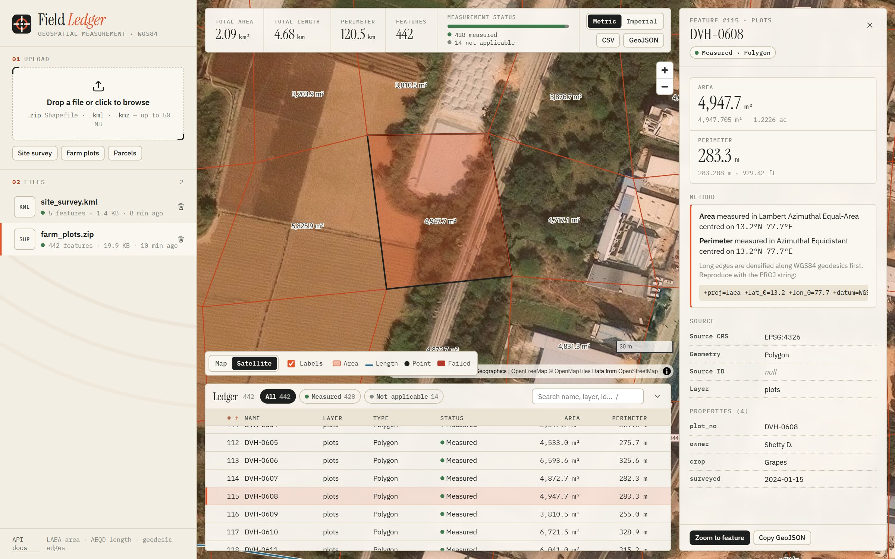
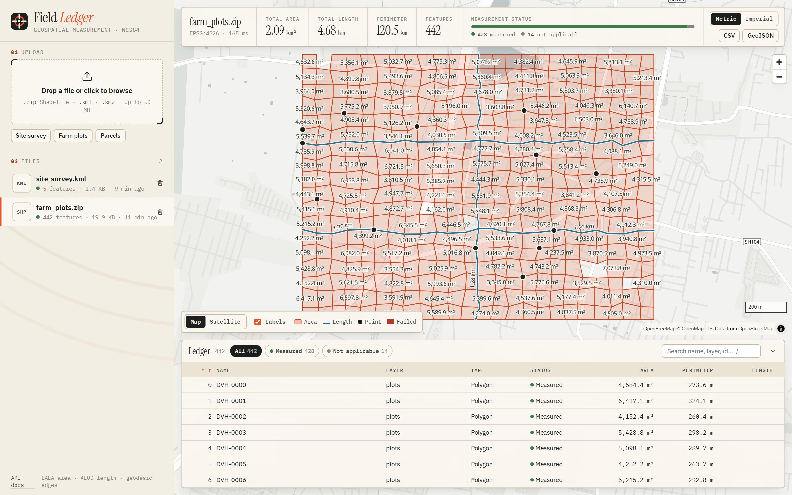
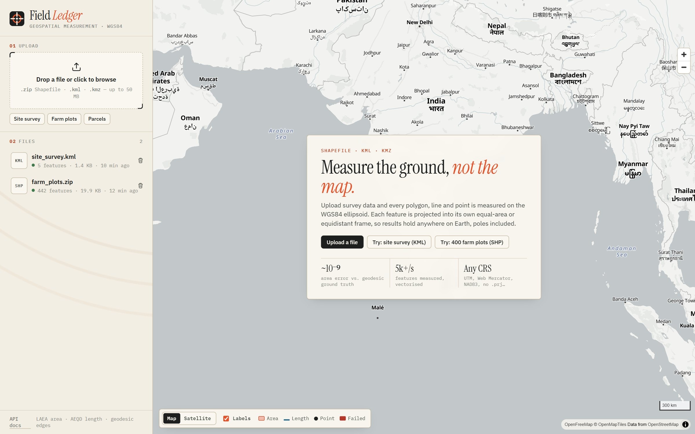
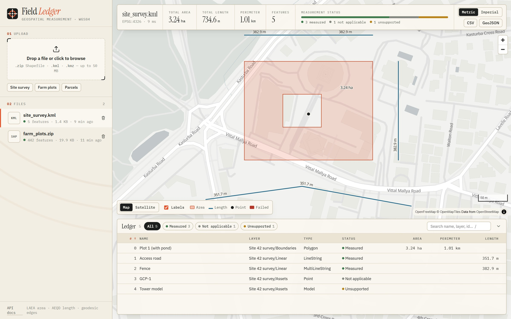

# Geospatial File Measurement API · Field Ledger

[](https://github.com/airasalish/geospatial-measurement-api/actions/workflows/ci.yml)


A FastAPI service that accepts a **zipped Shapefile, KML or KMZ**, extracts every
feature (ID, geometry type, geometry, CRS, attributes), and returns **areas,
perimeters and lengths in metres**. Measurements agree with ellipsoidal (geodesic)
ground truth to about **1 part in 10⁹** anywhere on Earth, poles included.

It ships with **Field Ledger**, a map-first web UI (React + TypeScript + MapLibre)
served by the same process: drop a file, see every feature on a map or satellite
imagery with its measurement, and inspect exactly how each number was computed.



```text
POST /api/files/                     upload + process  -> 201, file info
GET  /api/files/{id}/                file info (status, CRS, feature count, bbox, ...)
GET  /api/files/{id}/measurements/   per-feature area / perimeter / length + totals
GET  /api/files/{id}/features/       per-feature geometry (GeoJSON), CRS, properties
GET  /api/files/{id}/geojson/        whole file as a WGS84 FeatureCollection, for maps
```

**Highlights**

- **Accurate measurement anywhere.** Each feature is measured in its own projection:
  equal-area (LAEA) for area, equidistant (AEQD) for length. Long edges are first
  densified along geodesics. The test suite checks results against `pyproj.Geod`.
- **Handles real-world files.** Multi-layer zips, nested folders, `__MACOSX` junk,
  `.cpg` encodings, missing `.prj`, NULL shapes, 3D coordinates, self-intersecting
  polygons, KML `MultiGeometry`, both styles of polygon holes, KML 2.0–2.2 namespaces.
- **Fails one feature, not the file.** Every feature gets a status:
  `MEASURED`, `NOT_APPLICABLE`, `UNSUPPORTED` or `FAILED`, with a human-readable note.
- **Safe with hostile input.** Zip-bomb and zip-slip protection, XXE and
  billion-laughs protection, streaming upload size limits, no recursion on
  attacker-controlled nesting.
- **Fast.** Vectorised batch pipeline: ~5–8k features/s on a laptop (about 3.5–5.5×
  faster than the naive per-feature version). See [Performance](#performance).
- **A UI worth using.** A map with survey-plan labels, a satellite toggle, a
  virtualised feature ledger (sort, filter, search across 100k rows), a feature
  inspector showing the exact projection, metric/imperial units, CSV/GeoJSON export,
  and shareable deep links (`?file=…&feature=…`). See [Web UI](#web-ui).
- **Quality gates:** 104 backend tests at ~95% branch coverage, 11 frontend unit tests,
  `mypy --strict`, strict TypeScript, `ruff`, and CI that builds the Docker image and
  smoke-tests it end to end.

---

## Contents

- [Setup](#setup)
- [Web UI](#web-ui)
- [API](#api)
- [Architecture](#architecture)
- [CRS handling and measurement](#crs-handling-and-measurement)
- [Design decisions](#design-decisions)
- [Performance](#performance)
- [Testing](#testing)
- [Learnings](#learnings)
- [Future scope](#future-scope)

---

## Setup

Requires **Python 3.12+**. The geospatial dependencies (`shapely`, `pyproj`) ship
binary wheels, so there is **no GDAL install**.

```bash
git clone https://github.com/airasalish/geospatial-measurement-api.git
cd geospatial-measurement-api

python -m venv .venv
source .venv/bin/activate          # Windows: .venv\Scripts\activate
pip install -e ".[dev]"

# Build the web UI once (Node 20+). FastAPI serves it at / when frontend/dist exists.
npm --prefix frontend ci
npm --prefix frontend run build

uvicorn app.main:app --reload
```

Open **http://localhost:8000** for the UI and **http://localhost:8000/docs** for the
interactive API docs. The UI's sample buttons upload the files in [`samples/`](samples).

**Frontend development** (hot reload, with API calls proxied to :8000):

```bash
npm --prefix frontend run dev      # http://localhost:5173
```

### Docker

The image is multi-stage: Node builds the UI, then a slim Python image serves the
API and UI from one process.

```bash
docker build -t field-ledger .
docker run -p 8000:8000 -v geo-data:/srv/data field-ledger
```

### Deploy

[`render.yaml`](render.yaml) is a one-click blueprint for [Render](https://render.com)
(free plan; the Docker image reads `$PORT`). The same image runs unchanged on
Railway, Fly.io or Cloud Run.

### Configuration

All settings are environment variables with a `GEO_` prefix. They can also be set
in a `.env` file (see [`.env.example`](.env.example)).

| Variable | Default | Purpose |
|---|---|---|
| `GEO_DATABASE_URL` | `sqlite:///./data/geo.db` | Any SQLAlchemy URL (e.g. PostgreSQL) |
| `GEO_MAX_UPLOAD_BYTES` | 50 MB | Upload size limit (enforced while streaming) |
| `GEO_MAX_UNCOMPRESSED_BYTES` | 500 MB | Zip-bomb guard: total uncompressed size |
| `GEO_MAX_COMPRESSION_RATIO` | 200 | Zip-bomb guard: compression ratio |
| `GEO_MAX_ARCHIVE_MEMBERS` | 1000 | Max files inside a zip |
| `GEO_MAX_FEATURES` | 250,000 | Max features per file |
| `GEO_DEFAULT_PAGE_SIZE` / `GEO_MAX_PAGE_SIZE` | 100 / 1000 | Pagination |
| `GEO_MAX_GEOJSON_FEATURES` | 100,000 | Cap for the map endpoint |
| `GEO_CORS_ORIGINS` | *(none)* | Comma-separated origins, only needed if the UI is hosted elsewhere |

---

## Web UI

**Field Ledger** uses the visual language of a survey plan: paper and ink tones, a
survey-flag accent, serif readouts and monospaced figures that line up like a field
book. Everything on screen comes from the public API; the UI has no private endpoints.



| | |
|---|---|
|  |  |

- **Map.** Features are coloured by kind and status (failed and unsupported stand
  out), with on-map area and length labels in the current units. Map or **satellite**
  basemap, scale bar, hover tooltips.
- **Readout.** Total area, length and perimeter, feature count, a status breakdown
  bar, metric/imperial switch, CSV and GeoJSON export.
- **Ledger.** A virtualised table (only visible rows are rendered, so 100k features
  stay smooth): sort by any column, filter by status, search (`/` to focus). Click a
  row to fly to the feature.
- **Inspector.** Big readouts with exact values (m² and acres, m and ft), the
  **projection behind each value** (e.g. "LAEA centred on 13.2°N 77.7°E" plus the PROJ
  string to reproduce it), notes such as "invalid polygon repaired", source CRS and
  all attributes. Copy the geometry as GeoJSON.
- **Upload.** Drag and drop with real upload progress, then a processing state. Errors
  show the API's code and message, with a link to the recorded FAILED file.
- **Shareable state.** `?file=<id>&feature=<n>&basemap=satellite` restores the exact
  view. `Esc` closes the inspector.

Basemaps are keyless: [OpenFreeMap](https://openfreemap.org) vector tiles and Esri
World Imagery. Fonts are bundled (Latin subsets only), and MapLibre is split into its
own long-cached chunk.

---

## API

Interactive OpenAPI docs are served at `/docs` (Swagger) and `/redoc`. Trailing
slashes are optional.

### `POST /api/files/` — upload and process

`multipart/form-data` with a `file` field. Accepted formats:

| Extension | Content |
|---|---|
| `.zip` | One or more Shapefiles (`.shp` + `.shx` + `.dbf`, optional `.prj` / `.cpg`), possibly in sub-folders |
| `.kml` | KML 2.0 – 2.2 |
| `.kmz` | Zipped KML (`doc.kml`) |

```bash
curl -F "file=@samples/site_survey.kml" http://localhost:8000/api/files/
```

`201 Created`, with a `Location` header pointing at the new resource:

```json
{
  "id": "c8efebc8-4fff-479f-a9bb-a94cca33f3fd",
  "filename": "site_survey.kml",
  "format": "kml",
  "size_bytes": 1447,
  "sha256": "4b9b6f2782e12ca534922699fdf669e6eccfb7ee3e79737cc470112a649219f2",
  "status": "COMPLETED",
  "error": null,
  "crs": "EPSG:4326",
  "feature_count": 5,
  "layers": ["Site 42 survey/Boundaries", "Site 42 survey/Linear", "Site 42 survey/Assets"],
  "bbox": [77.594, 12.9709, 77.5972, 12.9735],
  "warnings": [],
  "processing_ms": 5.66,
  "created_at": "2026-10-11T07:49:39.693416Z",
  "processed_at": "2026-10-11T07:49:39.699683Z"
}
```

`crs` is the source CRS (`"MIXED"` if a zip's layers differ, `null` if unknown).

**Errors** all share one shape: `{"error": {"code": ..., "message": ..., "file_id"?: ...}}`.

| Status | `code` | When |
|---|---|---|
| 413 | `file_too_large` | Upload over `GEO_MAX_UPLOAD_BYTES` |
| 415 | `unsupported_file_type` | Not `.zip` / `.kml` / `.kmz` |
| 422 | `invalid_file` | Unreadable content (corrupt zip, malformed XML, missing `.dbf`, zip bomb, ...). The file is still recorded with `status: FAILED`, and `file_id` lets you fetch it. |

### `GET /api/files/{id}/` — file information

Returns the same object as the upload response. `GET /api/files/` lists all
uploads (paginated), and `DELETE /api/files/{id}/` removes a file and its features.

### `GET /api/files/{id}/measurements/` — measurements

Query parameters: `status` (e.g. `MEASURED`), `geometry_type` (e.g. `Polygon`,
case-insensitive), `limit`, `offset`. `summary` always covers the whole file.
`total` counts the features that match the filters.

```bash
curl "http://localhost:8000/api/files/{id}/measurements/"
```

```json
{
  "file_id": "c8efebc8-4fff-479f-a9bb-a94cca33f3fd",
  "units": {"area": "m2", "perimeter": "m", "length": "m"},
  "summary": {
    "feature_count": 5,
    "total_area_m2": 32408.162,
    "total_perimeter_m": 1006.704,
    "total_length_m": 734.589,
    "by_status": {"MEASURED": 3, "NOT_APPLICABLE": 1, "UNSUPPORTED": 1},
    "by_geometry_type": {"LineString": 1, "Model": 1, "MultiLineString": 1, "Point": 1, "Polygon": 1}
  },
  "total": 5,
  "limit": 100,
  "offset": 0,
  "items": [
    {
      "index": 0,
      "source_id": "plot-1",
      "layer": "Site 42 survey/Boundaries",
      "geometry_type": "Polygon",
      "status": "MEASURED",
      "area_m2": 32408.162,
      "perimeter_m": 1006.704,
      "length_m": null,
      "measurement_crs": {
        "area": "+proj=laea +lat_0=13.0 +lon_0=77.6 +datum=WGS84 +units=m +no_defs",
        "perimeter": "+proj=aeqd +lat_0=13.0 +lon_0=77.6 +datum=WGS84 +units=m +no_defs"
      },
      "note": null
    },
    {
      "index": 1, "source_id": "road-1", "layer": "Site 42 survey/Linear",
      "geometry_type": "LineString", "status": "MEASURED",
      "area_m2": null, "perimeter_m": null, "length_m": 351.651, "...": "..."
    },
    {
      "index": 3, "source_id": "gcp-1", "geometry_type": "Point",
      "status": "NOT_APPLICABLE", "...": "..."
    },
    {
      "index": 4, "source_id": "tower-1", "geometry_type": "Model",
      "status": "UNSUPPORTED", "note": "KML <Model> geometries are not supported.", "...": "..."
    }
  ]
}
```

| Geometry | Measured | Status |
|---|---|---|
| Polygon, MultiPolygon | `area_m2`, `perimeter_m` (holes subtracted from area; hole edges included in perimeter) | `MEASURED` |
| LineString, MultiLineString | `length_m` | `MEASURED` |
| GeometryCollection | area of the polygon parts + length of the line parts | `MEASURED` |
| Point, MultiPoint, no geometry | — | `NOT_APPLICABLE` |
| KML `Model` / `gx:Track`, Shapefile `MultiPatch` | — | `UNSUPPORTED` |
| Malformed or empty geometry, unknown non-lon/lat CRS | — | `FAILED` (+ `note`) |

`measurement_crs` records the exact projection behind each number, so any value can
be reproduced independently.

### `GET /api/files/{id}/geojson/` — map-ready FeatureCollection

Every feature in **WGS84**, with its measurement as properties (`index`, `name`,
`geometry_type`, `status`, `area_m2`, `perimeter_m`, `length_m`, `layer`,
`source_id`). It is built for web maps: the WGS84 geometry is computed once at
ingestion (vectorised), stored as GeoJSON text, and **streamed** from a server-side
cursor without being parsed, so memory stays flat. `name` is the feature's name
attribute, falling back to an id-like one (`plot_no`, `well_id`, …). The
`X-Total-Count` and `X-Truncated` headers report the cap (`GEO_MAX_GEOJSON_FEATURES`).
Geometries that can't be placed on Earth (no CRS and coordinates that aren't
lon/lat) come back as `null`.

### `GET /api/files/{id}/features/` — features

Each feature's identifier, geometry type, **GeoJSON geometry in the source CRS**,
CRS, and properties. Same pagination and `geometry_type` filter.
`GET /api/files/{id}/features/{index}/` returns a single feature.

```json
{
  "index": 0,
  "source_id": null,
  "layer": "parcels",
  "geometry_type": "Polygon",
  "crs": "EPSG:32643",
  "geometry": {"type": "Polygon", "coordinates": [[[777000.0, 1435000.0], [777000.0, 1435100.0], "..."]]},
  "properties": {"parcel_id": "P-001", "owner": "Ravi", "surveyed": "2024-01-15"}
}
```

`index` (0-based position in the file) is the stable feature ID. `source_id` holds
the source's own identifier when there is one (KML `<Placemark id>`).

---

## Architecture

```text
app/
├── main.py              App factory, error handler, /health, serves the built UI
├── config.py            Settings from environment variables (pydantic-settings)
├── db.py                Engine/session; SQLite pragmas (WAL, foreign keys)
├── models.py            ORM: UploadedFile 1──* Feature
├── schemas.py           Pydantic response models (the public contract)
├── errors.py            Domain errors -> HTTP status codes
├── api/files.py         HTTP layer: validation, streaming upload, pagination
├── services/
│   ├── ingestion.py     Pipeline: read -> measure -> persist (no HTTP code here)
│   └── queries.py       Read side; summaries aggregated in SQL
└── geo/                 Pure geospatial logic (no web or DB code)
    ├── types.py         RawFeature / Layer / Dataset (format-agnostic)
    ├── archive.py       SafeZip: in-memory, size-capped zip access
    ├── readers/         Format detection + Shapefile, KML/KMZ readers
    ├── crs.py           CRS description, reprojection, densification, local projections
    └── measure.py       Vectorised batch measurement

frontend/                React 18 + TypeScript (strict) + MapLibre GL, built with Vite
├── src/api.ts           Typed client mirroring app/schemas.py (XHR upload progress)
├── src/units.ts         Unit conversion and formatting (unit-tested)
├── src/components/      MapView, Ledger (virtualised), Inspector, Overlays, Sidebar
└── src/styles.css       Design tokens and components, no CSS framework
```

The layers depend in one direction only: `api -> services -> geo`. The `geo`
package knows nothing about HTTP or the database, so it is unit-tested directly
and could be reused in a worker or CLI unchanged.

### File-processing flow

```text
POST /api/files/
  │ 1. extension check (415) ─ before reading the body
  │ 2. stream the upload in 1 MB chunks, abort past the size limit (413)
  ▼
ingest_upload()
  │ 3. INSERT file row, status=PROCESSING, sha256; commit (so failures stay visible)
  │ 4. sniff content vs extension (a .zip must start with PK\x03\x04, etc.)
  │ 5. reader -> Dataset of Layers, each with a CRS and a lazy feature iterator
  │      .zip: SafeZip -> group members by stem -> per layer: .prj -> CRS, .cpg -> encoding,
  │            pyshp -> shapely (ring orientation -> holes)
  │      .kml: defusedxml -> iterative walk of Document/Folder -> Placemark -> geometry + ExtendedData
  │ 6. for each batch of 2,000 features:
  │      measure_batch()  ── vectorised (see below)
  │      shapely.to_geojson() for the whole batch
  │      Core executemany INSERT
  │ 7. status=COMPLETED, crs, layers, warnings, processing_ms; commit
  │
  └─ on any error: rollback (no partial features), status=FAILED + error; 422 with file_id
```

### Measurement flow

```text
measure_batch(features, source_crs)
  1. classify (per feature, cheap):  None/empty/point/unsupported -> settled now
                                     unknown CRS -> lon/lat-looking? assume 4326 : FAILED
                                     else split into polygonal + lineal parts
  2. polygonal parts (numpy array):  -> WGS84 (one pyproj call)
                                     -> make_valid() only where is_valid() is False
                                     -> geodesic densify only where a segment > 1 km
                                     -> group by snapped centroid -> LAEA -> shapely.area
                                                                 -> AEQD -> shapely.length
  3. lineal parts:                   -> WGS84 -> densify -> AEQD -> shapely.length
  4. non-finite results -> FAILED;   values rounded to mm
```

---

## CRS handling and measurement

The brief says not to compute area or distance in degrees, and to project first.
How you choose that projection decides how accurate the answer is.

### The strategy

1. **Find the source CRS.** For KML it is always WGS84 (OGC KML spec). For a
   Shapefile it comes from the `.prj`. If the `.prj` is missing and every coordinate
   fits within ±180/±90, EPSG:4326 is assumed and noted on the feature. If the
   coordinates are clearly projected, the service **refuses to guess** and the
   feature is `FAILED`. A wrong number is worse than no number.
2. **Normalise to WGS84.** One code path then covers geographic CRSs on other
   datums (NAD83, ETRS89) and projected CRSs. That includes Web Mercator, which
   is projected but inflates areas by 1/cos²(lat) (×4 at 60°N). It is a classic
   trap, and there is a test for it.
3. **Densify along geodesics.** Any segment longer than 1 km gets intermediate
   vertices on the ellipsoidal geodesic. This keeps edge semantics the same for
   every projection: the edge between two vertices is the shortest path on Earth.
   Without this step a 1° square differs from ground truth by about 1e-4.
4. **Project each feature into its own CRS, centred on it.**
   - **Area:** Lambert Azimuthal Equal-Area. Equal-area projections preserve area
     *by construction*, wherever the feature is.
   - **Length / perimeter:** Azimuthal Equidistant. Scale error grows with the square
     of the distance from the centre: ≤1e-5 for features up to ~100 km across
     (a 120 km test line comes out at 1e-6).
5. **Measure in metres** with shapely and round to millimetres.

### Why not UTM?

UTM is the usual choice, and it is what I first considered. It has three problems:

- **Built-in scale error.** UTM's scale factor is 0.9996 at the central meridian
  and about 1.001 at the zone edges, which means area errors of **0.05–0.2%**.
  `samples/parcels_utm43n.zip` shows this: a parcel that is exactly 100 m × 100 m
  in UTM coordinates (277 km from the central meridian) covers **9,989.0 m²** on
  the ellipsoid, not 10,000.
- Features that **cross a zone boundary** need special handling.
- UTM **doesn't exist beyond 84°N / 80°S.**

Accuracy against `pyproj.Geod` (Karney's ellipsoidal algorithms):

| Polygon | Geodesic area (m²) | This service | Local UTM zone |
|---|---:|---:|---:|
| 1 km² plot, Bengaluru | 1,200,290 | **1.3e-9** | 1.2e-3 |
| ~1,000 km², Bengaluru | 1,080,788,457 | **3.0e-9** | 9.5e-4 |
| 1° box, Norway 60°N | 6,122,943,163 | **3.0e-9** | 6.5e-4 |
| Box straddling a UTM zone edge | 8,686,379,302 | **3.0e-9** | 5.4e-4 |
| 2° box at 85°N | 3,479,879,608 | **3.0e-9** | n/a (outside UTM) |

| Line | Geodesic length (m) | Relative error |
|---|---:|---:|
| 2 km road | 1,967.9 | 2.6e-7 (mm rounding) |
| 120 km pipeline, 60°N | 157,097.8 | 1.0e-6 |
| 500 km line | 471,122.4 | 1.3e-8 |

### Why project at all, instead of computing geodesics directly?

`pyproj.Geod.geometry_area_perimeter` gives the ground truth directly, and it is
what the tests use. The brief explicitly asks for a projected-CRS approach, and that
approach generalises: the same projected geometry supports buffers, intersections
and other planar operations a real platform needs. Geodesic computation is the
right tool to *validate* the projected results, and that is how it is used here.

### Performance of the CRS step

Creating a pyproj `Transformer` costs milliseconds, so transformers are cached
(LRU). Projection centres are snapped to a **0.1° grid** so nearby features share
one. A batch of 2,000 features in one survey area usually needs only a handful of
transform calls instead of 4,000. Snapping does not change LAEA areas at all, and
it shifts the AEQD centre by at most ~8 km (error under 1e-6).

---

## Design decisions

| Decision | Why | Alternatives considered |
|---|---|---|
| **FastAPI** | Typed request/response models produce the OpenAPI docs for free. Async upload streaming. Light weight for a single-resource service. | Django + DRF: better admin and ORM migrations, but heavier than this scope needs. |
| **pyshp + defusedxml + shapely + pyproj** instead of GDAL/Fiona/GeoPandas | Pure wheels: `pip install` works on Windows, macOS and slim Docker with no system GDAL. Full control over error handling, so one bad feature never sinks the file. | GeoPandas + pyogrio: faster reading and more formats, but a ~100 MB native dependency, and less control when a single feature is malformed. Would revisit for very large files. |
| **Process synchronously in the request** (in a thread pool) | Simple, deterministic, and the client gets results immediately. Files are capped (50 MB, 250k features). `status` and the service layer are already built for async. | Background worker (Celery/RQ/arq) with `PROCESSING` -> poll. This is the next step for larger files. `ingest_upload` has no HTTP dependencies, so moving it is a small change. |
| **Measure at upload time, store results** | Reads (`GET .../measurements/`) are pure DB queries, cheap and paginated. Summaries are SQL aggregates. | Compute on every GET: no storage, but repeated CPU work on every read. |
| **SQLite (WAL) + SQLAlchemy 2.0**, geometry stored as GeoJSON text | No setup. WAL lets reads run during writes. Swap `GEO_DATABASE_URL` for PostgreSQL. | PostGIS: spatial indexes and queries. Worth it once spatial filtering is needed (see Future scope). |
| **Per-feature status instead of failing the whole file** | Real survey data is messy: one bad Placemark shouldn't hide 10,000 good ones. | All-or-nothing validation: simpler, but hostile to users. |
| **Record failed uploads** (`status: FAILED`) | Gives an audit trail and a clear error to look up later. The 422 response includes `file_id`. | Return an error and keep nothing. |
| **Feature `index` as the public ID** | Always present, stable, unique within a file. The source ID (`source_id`) is optional and not guaranteed unique. | Global surrogate keys: they leak the DB's internals into the API. |
| **Return geometry in the source CRS** | Lossless: exactly what the user uploaded. The CRS is reported next to it. | Always reproject to WGS84 GeoJSON (RFC 7946). It could be added as a `?crs=` option. |
| **Refuse to guess projected coordinates without a CRS** | A silently wrong area is the worst outcome for a measurement API. | Default to some CRS: gives plausible-looking but wrong numbers. |

### Robustness and security

| Threat / edge case | Handling |
|---|---|
| Huge upload | Read in 1 MB chunks and aborted past the limit (413) before buffering more |
| Zip bomb | Declared size, compression ratio and member-count limits, plus a hard read budget that doesn't trust zip headers |
| Zip slip | Archives are never extracted to disk; members are read into memory by name |
| XXE / billion laughs | `defusedxml` rejects DTDs and entities |
| Deeply nested KML | Iterative tree walk; nested `MultiGeometry` recursion is caught |
| Renamed files | Content is sniffed: a `.zip` must actually be a zip, and a `.kml` must not be one |
| Client paths in filenames | `C:\fakepath\x.kml` is stored as `x.kml` |
| Self-intersecting polygons | `make_valid` before measuring (a bow-tie would otherwise measure ~0), with a note |
| Failure part-way through a file | The transaction is rolled back, so there are no partial feature sets |

---

## Performance

Run `python -m scripts.benchmark --features 50000` to generate a synthetic 50k-polygon
Shapefile and time the full ingestion: read, measure, encode and insert.

| Version | Throughput (50k polygons, laptop) |
|---|---|
| Naive: per-feature transforms, ORM inserts | ~1,400 features/s |
| Vectorised batch pipeline (current) | **~5,000–7,800 features/s** |

What made the difference, as found by profiling with `cProfile`:

1. **Vectorised reprojection.** One pyproj call per batch instead of three per
   feature, and one call per *projection-centre group* instead of per feature.
2. **Recomputed cache keys.** `crs.to_wkt()` was running for every feature
   (2.2 s per 20k features). It now runs once per batch.
3. **Core `executemany` instead of ORM bulk insert.** Skips per-row ORM bookkeeping.
4. **Vectorised `shapely.to_geojson`**, stored as text: no dict round trip through `json`.
5. **Conditional work.** `make_valid` and densification run only where they are needed,
   based on vectorised `is_valid` and vectorised geodesic segment lengths.

The remaining time is mostly the pure-Python Shapefile reader. See Future scope.

---

## Testing

```bash
pytest                       # 104 tests
pytest --cov                 # ~95% branch coverage
ruff check . && ruff format --check .
mypy app                     # strict mode

npm --prefix frontend test           # 11 unit tests (units, CSV export, bounds)
npm --prefix frontend run typecheck  # strict TypeScript
```

| Suite | What it covers |
|---|---|
| `tests/test_measure.py` | **Accuracy against geodesic ground truth** at the equator, high latitude, the southern hemisphere, the prime meridian, UTM zone edges and >84°N. Holes, multipolygons, 3D input, projected source CRSs (UTM, Web Mercator), non-WGS84 datums, invalid geometry repair, all non-measurable cases. |
| `tests/test_readers.py` | KML namespaces, folders, ExtendedData/SchemaData, both hole encodings, MultiGeometry collapse, malformed features, XXE, entity expansion, deep nesting, KMZ. Shapefile multi-layer, nested folders, `.cpg`, missing `.prj`/`.dbf`/`.shx`, NULL shapes, ring orientation. Zip bombs, corrupt archives, content sniffing. |
| `tests/test_api.py` | Every endpoint end to end: status codes, `Location` header, pagination and caps, filters, error shapes, FAILED records, transaction rollback on mid-file failure, cascade delete. GeoJSON streaming (reprojection from UTM, `null` for unplaceable geometry, truncation), file bbox, CORS, and the UI mount not shadowing API routes or slash redirects. |
| `frontend/src/*.test.ts` | Unit formatting and auto-scaling, PROJ-string parsing, CSV quoting and the formula-injection guard, geometry bounds. |

The test inputs are built in code (`tests/factories.py`), not stored as binary
fixtures, so every test shows exactly what it feeds in. `python -m scripts.make_samples`
regenerates `samples/`.

---

## Learnings

- **Projected doesn't mean measurable.** Web Mercator is a projected CRS in
  metres, yet its areas are wrong by a factor of 4 at 60°N. Measurement needs a
  projection chosen *for the property being measured* (equal-area for area).
- **UTM's error is real.** I assumed UTM was effectively exact for small parcels.
  Measuring against geodesic ground truth showed a consistent ~0.1% bias, which
  is 10 m² on a hectare: a lot in land records.
- **Edge semantics matter.** My first test run failed at 1e-4 for large polygons.
  The projection wasn't wrong: a straight line in any projection is not the
  geodesic. Geodesic densification fixed it. Testing against an independent
  ground truth caught a bug I wouldn't have thought to look for.
- **Profile before optimising.** I expected projection math to dominate. The
  biggest single surprise was `CRS.to_wkt()` being called as a cache key for every
  feature, and the ORM insert path cost more than all the geometry work.
- **Real files are messy.** `__MACOSX` folders, upper-case `.PRJ`, unclosed KML
  rings and `lon, lat` with spaces all came up while writing tests.

## Future scope

- **Background processing.** Move `ingest_upload` to a worker queue (arq/Celery +
  Redis), return `202 Accepted` with `PROCESSING`, and add progress reporting. Keep
  sync mode for small files.
- **PostGIS.** Native geometry columns, a spatial index, and endpoints such as
  `?bbox=` filtering and "features within polygon".
- **More formats.** GeoJSON, GeoPackage, DXF. A GDAL-backed reader (pyogrio) for
  high-volume ingestion: the reader is now the bottleneck.
- **Output options.** Server-side CSV/GeoPackage export and arbitrary `?crs=` output
  reprojection. WGS84 GeoJSON and client-side CSV already exist.
- **UI.** Vector tiles from PostGIS for million-feature files, drawing and editing
  geometry, and comparing two uploads.
- **3D / terrain.** Surface (slope-aware) area and 3D length using the Z values that
  drone surveys provide, or a DEM.
- **Antimeridian-crossing features.** Split geometries at ±180° before measuring.
- **Duplicate-upload detection.** `sha256` is already stored, so an identical file could
  return the existing result.
- **Operations.** Alembic migrations, authentication with per-tenant isolation,
  object storage for raw uploads, structured logging, metrics.

## License

[MIT](LICENSE)
