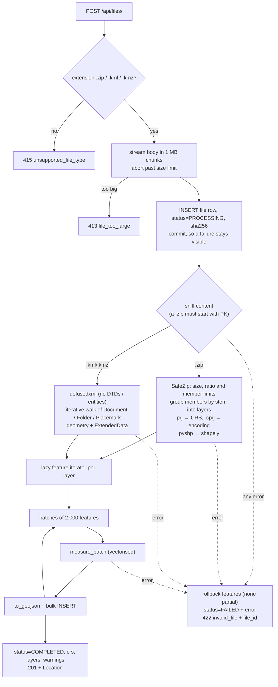
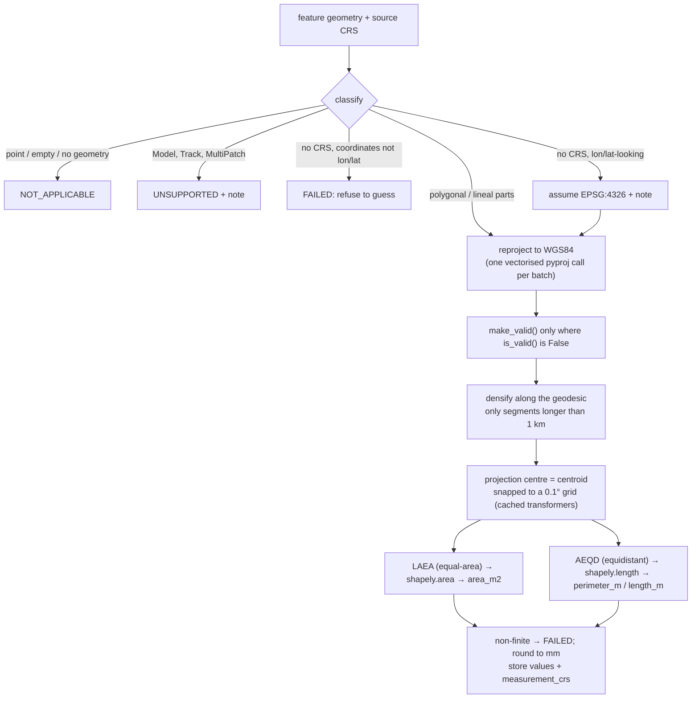

<p align="center"></p>

<h1 align="center">Geospatial File Measurement API</h1>
<p align="center"><b>Upload a Shapefile or KML, get every feature back with its area or length in metres.</b><br>FastAPI · shapely · pyproj · measured in a projection chosen per feature, validated against geodesic ground truth</p>

[](https://github.com/airasalish/geospatial-measurement-api/actions/workflows/ci.yml)


**Live demo: [traverse-survey.onrender.com](https://traverse-survey.onrender.com)** ·
API docs: [/docs](https://traverse-survey.onrender.com/docs)
<sub>(free tier: the first request after a quiet spell takes ~30 s to wake the server.)</sub>

```bash
curl -F "file=@samples/site_survey.kml" https://traverse-survey.onrender.com/api/files/
curl https://traverse-survey.onrender.com/api/files/{id}/
curl https://traverse-survey.onrender.com/api/files/{id}/measurements/
```

The service accepts a **zipped Shapefile or a KML** (and KMZ), extracts every feature
(ID, geometry type, geometry, CRS, properties), and measures it: **area** (and
perimeter) for polygons, **length** for lines, nothing for points. Geometry is never
measured in degrees: each feature is projected into an **equal-area** projection
centred on it for area and an **equidistant** one for length. Results agree with
ellipsoidal ground truth (`pyproj.Geod`) to about **1 part in 10⁹**, anywhere on
Earth, which is roughly **10⁶× more accurate than the usual "pick the UTM zone"
approach** ([comparison](#why-not-utm)).


---

## Contents

- [Requirements checklist](#requirements-checklist)
- [Setup](#setup)
- [API](#api)
- [Architecture](#architecture): structure, file-processing flow, measurement flow, [CRS handling](#crs-handling)
- [Design decisions](#design-decisions)
- [Testing](#testing)
- [Learnings](#learnings)
- [Future scope](#future-scope)
- [Beyond the brief](#beyond-the-brief): web UI, DEM volumetrics, production stack

---

## Requirements checklist

Each requirement of the brief, where it is implemented, and the test that proves it.
[`tests/test_requirements.py`](tests/test_requirements.py) follows the brief item by
item; the other test modules go deeper.

| # | Requirement | Implementation | Proof |
|---|---|---|---|
| 1 | FastAPI or Django | FastAPI, typed Pydantic contract, OpenAPI at `/docs` | `test_1_backend_is_fastapi` |
| 2 | `POST /api/files/` accepts `.zip` Shapefile and `.kml` | [`app/api/files.py`](app/api/files.py), readers in [`app/geo/readers/`](app/geo/readers) (also KMZ, multi-layer zips) | `test_2_upload_accepts_kml_and_zipped_shapefile` |
| 3 | Per feature: ID/index, geometry type, geometry, CRS, properties | `index`, `geometry_type`, `geometry` (GeoJSON, source CRS), `crs`, `properties` on every measurement item | `test_3_every_feature_has_id_type_geometry_crs_properties` |
| 3 | Unsupported geometry handled gracefully | Per-feature status `UNSUPPORTED` / `FAILED` with a note; the file still completes | `test_3_unsupported_geometry_is_reported_not_crashed` |
| 4 | Polygon area, LineString length, Point nothing | [`app/geo/measure.py`](app/geo/measure.py): `area_m2` (+ `perimeter_m`), `length_m`, `NOT_APPLICABLE` | `test_4_polygon_area_line_length_point_nothing` |
| 5 | Don't measure in degrees; project first | Per-feature LAEA (area) / AEQD (length), recorded in `measurement_crs` ([CRS handling](#crs-handling)) | `test_5_measured_in_a_projected_crs_not_degrees`, 40+ accuracy tests in `test_measure.py` |
| 6 | `GET /api/files/{id}/` with `id, filename, feature_count, crs, status` | Same object as the upload response | `test_6_file_information_matches_the_brief_example` |
| 6 | `GET /api/files/{id}/measurements/` | Per-feature measurements + whole-file summary, paginated and filterable | `test_6_measurements_endpoint` |
| 7 | README: setup, API, architecture, CRS, design decisions | This file | — |
| 8 | Learnings, future scope | [Learnings](#learnings), [Future scope](#future-scope) | — |

---

## Setup

Only **Python 3.12+** is needed. The geospatial libraries ship binary wheels, so
there is **no GDAL or other system install**.

```bash
git clone https://github.com/airasalish/geospatial-measurement-api.git
cd geospatial-measurement-api

python -m venv .venv
source .venv/bin/activate          # Windows: .venv\Scripts\activate
pip install -e ".[dev]"

uvicorn app.main:app --reload
```

The API is now at **http://localhost:8000/api/files/** with interactive docs at
**http://localhost:8000/docs**. It uses SQLite in `./data/` and needs no other services.
Try it with the files in [`samples/`](samples):

```bash
curl -F "file=@samples/site_survey.kml" http://localhost:8000/api/files/       # KML: polygon with a hole, lines, point, Model
curl -F "file=@samples/parcels_utm43n.zip" http://localhost:8000/api/files/    # Shapefile in UTM 43N
curl -F "file=@samples/farm_plots.zip" http://localhost:8000/api/files/        # 3 layers, 442 features, EPSG:4326
pytest                                                                          # run the tests
```

**Optional web UI** (needs Node 20+): build it once and the same server serves it at `/`.

```bash
npm --prefix frontend ci && npm --prefix frontend run build
```

**Docker:**

```bash
docker build -t geo-api . && docker run -p 8000:8000 geo-api   # API + UI, SQLite
docker compose up --build                                       # + PostGIS, Redis worker, S3, Prometheus
```

Settings are `GEO_*` environment variables (upload limits, database URL, ...); see
[`.env.example`](.env.example) and the [full table](docs/operations.md#configuration).

---

## API

| Method | Path | Purpose |
|---|---|---|
| `POST` | **`/api/files/`** | Upload and process a file → `201` + file information |
| `GET` | **`/api/files/{id}/`** | File information |
| `GET` | **`/api/files/{id}/measurements/`** | Per-feature measurements and totals |
| `GET` | `/api/files/` | List uploads (paginated) |
| `DELETE` | `/api/files/{id}/` | Delete a file and its features |
| `GET` | `/api/files/{id}/features/` · `/features/{index}/` | Features with full geometry (no measurements) |
| `GET` | `/api/files/{id}/geojson/` | Whole file as a WGS84 FeatureCollection, streamed, for web maps |

The first three are the brief's endpoints. Trailing slashes are optional. The
terrain, tile and auth endpoints are listed under [Beyond the brief](#beyond-the-brief).

### `POST /api/files/` — upload and process

`multipart/form-data` with a `file` field.

| Extension | Content |
|---|---|
| `.zip` | One or more Shapefiles (`.shp` + `.shx` + `.dbf`, optional `.prj` / `.cpg`), possibly in sub-folders |
| `.kml` | KML 2.0 – 2.2 |
| `.kmz` | Zipped KML |

```bash
curl -F "file=@samples/site_survey.kml" http://localhost:8000/api/files/
```

`201 Created`, with `Location: /api/files/{id}/`:

```json
{
  "id": "5107372a-842a-4329-b4e8-59f12e78178b",
  "filename": "site_survey.kml",
  "format": "kml",
  "size_bytes": 1447,
  "sha256": "4b9b6f2782e12ca534922699fdf669e6eccfb7ee3e79737cc470112a649219f2",
  "status": "COMPLETED",
  "error": null,
  "crs": "EPSG:4326",
  "feature_count": 5,
  "layers": ["Site 42 survey/Boundaries", "Site 42 survey/Linear", "Site 42 survey/Assets"],
  "bbox": [77.594, 12.9709, 77.5972, 12.9735],
  "warnings": [],
  "processing_ms": 5.48,
  "created_at": "2026-10-11T15:37:39.321430Z",
  "processed_at": "2026-10-11T15:37:39.327505Z"
}
```

`crs` is the file's source CRS: `"MIXED"` if a zip's layers differ, `null` if a
Shapefile has no `.prj`. `status` is `COMPLETED` or `FAILED` (or `PROCESSING` in the
optional queued mode, which returns `202`).

**Errors** all share one shape: `{"error": {"code": ..., "message": ..., "file_id"?: ...}}`.

| Status | `code` | When |
|---|---|---|
| 413 | `file_too_large` | Upload over `GEO_MAX_UPLOAD_BYTES` |
| 415 | `unsupported_file_type` | Not `.zip` / `.kml` / `.kmz` |
| 422 | `invalid_file` | Unreadable content (corrupt zip, malformed XML, missing `.dbf`, zip bomb, ...). The file is still recorded with `status: FAILED`, and `file_id` lets you fetch it. |

### `GET /api/files/{id}/` — file information

```bash
curl http://localhost:8000/api/files/5107372a-842a-4329-b4e8-59f12e78178b/
```

Returns the same object as the upload, so it contains every field of the brief's
example (`id`, `filename`, `feature_count`, `crs`, `status`) plus provenance
(`sha256`, `size_bytes`, timestamps), `layers`, `bbox` and `warnings`. Unknown id: `404`.

### `GET /api/files/{id}/measurements/` — measurements

| Query parameter | Effect |
|---|---|
| `include_geometry=true` | Add each feature's GeoJSON geometry (source CRS). Off by default to keep pages small |
| `status=MEASURED` | Only features with that status |
| `geometry_type=Polygon` | Only that geometry type (case-insensitive) |
| `bbox=minx,miny,maxx,maxy` | Only features intersecting a WGS84 box |
| `limit`, `offset` | Pagination (default 100, max 1000) |

```bash
curl "http://localhost:8000/api/files/5107372a-842a-4329-b4e8-59f12e78178b/measurements/?include_geometry=true"
```

```jsonc
{
  "file_id": "5107372a-842a-4329-b4e8-59f12e78178b",
  "filename": "site_survey.kml",
  "crs": "EPSG:4326",
  "units": {"area": "m2", "perimeter": "m", "length": "m"},
  "summary": {                                  // always the whole file, whatever the filters
    "feature_count": 5,
    "total_area_m2": 32408.162,
    "total_perimeter_m": 1006.704,
    "total_length_m": 734.589,
    "by_status": {"MEASURED": 3, "NOT_APPLICABLE": 1, "UNSUPPORTED": 1},
    "by_geometry_type": {"LineString": 1, "Model": 1, "MultiLineString": 1, "Point": 1, "Polygon": 1}
  },
  "total": 5, "limit": 100, "offset": 0,       // total = features matching the filters
  "items": [
    {
      "index": 0,                               // feature ID: 0-based position in the file
      "source_id": "plot-1",                    // the source's own id (KML <Placemark id>), if any
      "layer": "Site 42 survey/Boundaries",
      "geometry_type": "Polygon",
      "crs": "EPSG:4326",
      "status": "MEASURED",
      "area_m2": 32408.162,                     // pond (inner ring) subtracted
      "perimeter_m": 1006.704,                  // outer ring + pond edge
      "length_m": null,
      "measurement_crs": {                      // the exact projection behind each number
        "area": "+proj=laea +lat_0=13.0 +lon_0=77.6 +datum=WGS84 +units=m +no_defs",
        "perimeter": "+proj=aeqd +lat_0=13.0 +lon_0=77.6 +datum=WGS84 +units=m +no_defs"
      },
      "note": null,
      "properties": {"name": "Plot 1 (with pond)", "survey_date": "2024-03-14", "surveyor": "Team A"},
      "geometry": {"type": "Polygon", "coordinates": [[[77.5946, 12.9716, 0.0], [77.5966, 12.9716, 0.0], "..."], ["...pond..."]]}
    },
    {
      "index": 1, "source_id": "road-1", "layer": "Site 42 survey/Linear",
      "geometry_type": "LineString", "crs": "EPSG:4326", "status": "MEASURED",
      "area_m2": null, "perimeter_m": null, "length_m": 351.651,
      "measurement_crs": {"length": "+proj=aeqd +lat_0=13.0 +lon_0=77.6 +datum=WGS84 +units=m +no_defs"},
      "note": null, "properties": {"name": "Access road"},
      "geometry": {"type": "LineString", "coordinates": [[77.594, 12.971], [77.5955, 12.9712], [77.5972, 12.9709]]}
    },
    { "index": 2, "geometry_type": "MultiLineString", "status": "MEASURED", "length_m": 382.938, "...": "..." },
    {
      "index": 3, "source_id": "gcp-1", "geometry_type": "Point", "crs": "EPSG:4326",
      "status": "NOT_APPLICABLE", "area_m2": null, "perimeter_m": null, "length_m": null,
      "measurement_crs": {}, "note": null, "properties": {"name": "GCP-1"},
      "geometry": {"type": "Point", "coordinates": [77.5956, 12.9723, 0.0]}
    },
    {
      "index": 4, "source_id": "tower-1", "geometry_type": "Model", "crs": "EPSG:4326",
      "status": "UNSUPPORTED", "area_m2": null, "perimeter_m": null, "length_m": null,
      "measurement_crs": {}, "note": "KML <Model> geometries are not supported.",
      "properties": {"name": "Tower model"}, "geometry": null
    }
  ]
}
```

| Geometry | Measured | Status |
|---|---|---|
| Polygon, MultiPolygon | `area_m2`, `perimeter_m` (holes subtracted from area; hole edges included in perimeter) | `MEASURED` |
| LineString, MultiLineString | `length_m` | `MEASURED` |
| GeometryCollection | area of the polygon parts + length of the line parts | `MEASURED` |
| Point, MultiPoint, no geometry | — | `NOT_APPLICABLE` |
| KML `Model` / `gx:Track`, Shapefile `MultiPatch` | — | `UNSUPPORTED` |
| Malformed or empty geometry, unknown non-lon/lat CRS | — | `FAILED` (+ `note`) |

`measurement_crs` records the exact projection behind each number, so any value can
be reproduced independently.

---

## Architecture

### Application structure

```text
app/
├── main.py              App factory: routers, error handler, health/ready, metrics, UI mount
├── config.py            Settings from GEO_* environment variables
├── db.py                Engine/session, SQLite pragmas, Alembic migrate()
├── models.py            UploadedFile 1──* Feature, Raster, User, Project
├── schemas.py           Pydantic response models (the public contract)
├── auth.py              scrypt hashing, JWTs, user dependencies, tenancy helpers
├── storage.py           LocalStorage / S3Storage (+ GDAL /vsis3/ environment)
├── metrics.py           Prometheus metrics + HTTP middleware
├── worker.py            Celery app and tasks (same ingestion code as sync mode)
├── api/                 files, rasters (terrain), auth + projects
├── services/
│   ├── ingestion.py     Vector pipeline: read -> measure -> persist
│   ├── rasters.py       DEM lifecycle, geometry resolution
│   ├── queries.py       Read side; summaries aggregated in SQL
│   └── vector_tiles.py  MVT: ST_AsMVT on PostGIS, Python encoder on SQLite
├── geo/                 Pure vector geodesy (no web or DB code)
│   ├── archive.py · readers/ · crs.py · measure.py · types.py
└── terrain/             Pure DEM analytics (no web or DB code)
    ├── grid.py          True ground cell sizes in any CRS
    ├── ingest.py        Validation + Cloud-Optimised GeoTIFF conversion
    ├── analysis.py      Volumes, surface area, slope, profiles, altitude
    └── tiles.py         Elevation / hillshade / slope / terrarium tiles

migrations/              Alembic (0001 schema + PostGIS, 0002 users/projects)
frontend/                React 18 + TypeScript (strict) + MapLibre GL, built with Vite
├── src/api.ts · auth.ts Typed client, token handling
├── src/components/      MapView, Ledger, Inspector, Terrain (volume, profile, report), Account
└── src/styles.css       Design tokens and components, no CSS framework
deploy/                  Prometheus scrape config, S3 identities for compose
```

The layers depend in one direction only: `api -> services -> geo | terrain`. The
`geo` and `terrain` packages know nothing about HTTP or the database, so they are
tested directly against analytic ground truth, and the Celery worker reuses them
unchanged.

### File-processing flow



### Measurement flow



### CRS handling

The brief says not to measure in degrees and to project first. How the projection
is chosen decides how accurate the answer is.

#### The strategy

1. **Find the source CRS.** For KML it is always WGS84 (OGC KML spec). For a
   Shapefile it comes from the `.prj`. If the `.prj` is missing and every coordinate
   fits within ±180/±90, EPSG:4326 is assumed and noted on the feature. If the
   coordinates are clearly projected, the service **refuses to guess** and the
   feature is `FAILED`. A wrong number is worse than no number.
2. **Normalise to WGS84.** One code path then covers geographic CRSs on other
   datums (NAD83, ETRS89) and projected CRSs. That includes Web Mercator, which
   is projected but inflates areas by 1/cos²(lat) (×4 at 60°N). It is a classic
   trap, and there is a test for it.
3. **Densify along geodesics.** Any segment longer than 1 km gets intermediate
   vertices on the ellipsoidal geodesic. This keeps edge semantics the same for
   every projection: the edge between two vertices is the shortest path on Earth.
   Without this step a 1° square differs from ground truth by about 1e-4.
4. **Project each feature into its own CRS, centred on it.**
   - **Area:** Lambert Azimuthal Equal-Area. Equal-area projections preserve area
     *by construction*, wherever the feature is.
   - **Length / perimeter:** Azimuthal Equidistant. Scale error grows with the square
     of the distance from the centre: ≤1e-5 for features up to ~100 km across
     (a 120 km test line comes out at 1e-6).
5. **Measure in metres** with shapely and round to millimetres.

#### Why not UTM?

UTM is the usual choice, and it is what I first considered. It has three problems:

- **Built-in scale error.** UTM's scale factor is 0.9996 at the central meridian
  and about 1.001 at the zone edges, which means area errors of **0.05–0.2%**.
  `samples/parcels_utm43n.zip` shows this: a parcel that is exactly 100 m × 100 m
  in UTM coordinates (277 km from the central meridian) covers **9,989.0 m²** on
  the ellipsoid, not 10,000.
- Features that **cross a zone boundary** need special handling.
- UTM **doesn't exist beyond 84°N / 80°S.**

Accuracy against `pyproj.Geod` (Karney's ellipsoidal algorithms):

| Polygon | Geodesic area (m²) | This service | Local UTM zone |
|---|---:|---:|---:|
| 1 km² plot, Bengaluru | 1,200,290 | **1.3e-9** | 1.2e-3 |
| ~1,000 km², Bengaluru | 1,080,788,457 | **3.0e-9** | 9.5e-4 |
| 1° box, Norway 60°N | 6,122,943,163 | **3.0e-9** | 6.5e-4 |
| Box straddling a UTM zone edge | 8,686,379,302 | **3.0e-9** | 5.4e-4 |
| 2° box at 85°N | 3,479,879,608 | **3.0e-9** | n/a (outside UTM) |

| Line | Geodesic length (m) | Relative error |
|---|---:|---:|
| 2 km road | 1,967.9 | 2.6e-7 (mm rounding) |
| 120 km pipeline, 60°N | 157,097.8 | 1.0e-6 |
| 500 km line | 471,122.4 | 1.3e-8 |

#### Why project at all, instead of computing geodesics directly?

`pyproj.Geod.geometry_area_perimeter` gives the ground truth directly, and it is
what the tests use. The brief explicitly asks for a projected-CRS approach, and that
approach generalises: the same projected geometry supports buffers, intersections
and other planar operations a real platform needs. Geodesic computation is the
right tool to *validate* the projected results, and that is how it is used here.

#### Performance of the CRS step

Creating a pyproj `Transformer` costs milliseconds, so transformers are cached
(LRU). Projection centres are snapped to a **0.1° grid** so nearby features share
one. A batch of 2,000 features in one survey area usually needs only a handful of
transform calls instead of 4,000. Snapping does not change LAEA areas at all, and
it shifts the AEQD centre by at most ~8 km (error under 1e-6).

---

## Design decisions

| Decision | Why | Alternatives considered |
|---|---|---|
| **FastAPI** | Typed request/response models produce the OpenAPI docs for free. Async upload streaming. Light weight for a single-resource service. | Django + DRF: better admin and ORM migrations, but heavier than this scope needs. |
| **pyshp + defusedxml + shapely + pyproj** instead of GDAL/Fiona/GeoPandas | Pure wheels: `pip install` works on Windows, macOS and slim Docker with no system GDAL. Full control over error handling, so one bad feature never sinks the file. | GeoPandas + pyogrio: faster reading and more formats, but a ~100 MB native dependency, and less control when a single feature is malformed. Would revisit for very large files. |
| **A projection per feature: LAEA for area, AEQD for length**, centred on the feature | Equal-area is exact for area by construction; centring keeps distance error under 1e-5 for features up to ~100 km. Works at any latitude and across zone boundaries. ~10⁻⁹ vs geodesic truth ([table](#why-not-utm)) | Local UTM zone: the textbook answer, but 0.05–0.2% scale error, zone-crossing problems, nothing past 84°N. One fixed CRS (e.g. Web Mercator): area inflated by 1/cos²(lat). `Geod` directly: exact, but the brief asks for projection, and planar geometry is what later operations need (we use `Geod` to *test*) |
| **Geometry opt-in on `/measurements/`** (`?include_geometry=true`) | Measurement pages stay small (a parcel can have thousands of vertices); clients that need shapes ask for them, or use `/features/` or the streamed `/geojson/` | Always include geometry: simplest contract, but 10–100× larger responses for table views |
| **Two processing modes, one code path**: `sync` (in the request) and `celery` (202 + worker) | Sync keeps the demo a single container with immediate results. Celery handles large files and DEM conversion without tying up API workers. Both call the same `process_record` / `process_raster_record`, so behaviour can't diverge | Async-only (always queue): needs Redis even for the demo. FastAPI `BackgroundTasks`: no retries, and lost on restart |
| **Measure at upload time, store results** | Reads (`GET .../measurements/`) are pure DB queries, cheap and paginated. Summaries are SQL aggregates. | Compute on every GET: no storage, but repeated CPU work on every read. |
| **SQLite or PostgreSQL/PostGIS** behind one model; geometry stored as GeoJSON text plus bbox columns, and a native PostGIS `geom` column on Postgres | The demo runs with no database server; production gets GiST-indexed geometry and `ST_AsMVT`. Portable bbox columns keep spatial filtering and vector tiles working on both | GeoAlchemy2 geometry types in the ORM: ties the models to PostGIS and loses the zero-setup mode |
| **Per-feature status instead of failing the whole file** | Real survey data is messy: one bad Placemark shouldn't hide 10,000 good ones. | All-or-nothing validation: simpler, but hostile to users. |
| **Record failed uploads** (`status: FAILED`) | Gives an audit trail and a clear error to look up later. The 422 response includes `file_id`. | Return an error and keep nothing. |
| **Feature `index` as the public ID** | Always present, stable, unique within a file. The source ID (`source_id`) is optional and not guaranteed unique. | Global surrogate keys: they leak the DB's internals into the API. |
| **S3 + COGs read in place** (`/vsis3/`) | Tiles and analyses fetch only the blocks they need through HTTP range requests; nothing is copied to local disk | Download-then-read: simpler, but slow and disk-hungry for large DEMs |
| **Auth off by default, strict when on** | The public demo stays one-click; multi-tenant deployments get 404-not-403 isolation and refuse weak secrets | Always-on auth: a demo nobody can try without signing up |
| **Return geometry in the source CRS** | Lossless: exactly what the user uploaded. The CRS is reported next to it. | Always reproject to WGS84 GeoJSON (RFC 7946). It could be added as a `?crs=` option. |
| **Refuse to guess projected coordinates without a CRS** | A silently wrong area is the worst outcome for a measurement API. | Default to some CRS: gives plausible-looking but wrong numbers. |

### Robustness and security

| Threat / edge case | Handling |
|---|---|
| Huge upload | Read in 1 MB chunks and aborted past the limit (413) before buffering more |
| Zip bomb | Declared size, compression ratio and member-count limits, plus a hard read budget that doesn't trust zip headers |
| Zip slip | Archives are never extracted to disk; members are read into memory by name |
| XXE / billion laughs | `defusedxml` rejects DTDs and entities |
| Deeply nested KML | Iterative tree walk; nested `MultiGeometry` recursion is caught |
| Renamed files | Content is sniffed: a `.zip` must actually be a zip, and a `.kml` must not be one |
| Client paths in filenames | `C:\fakepath\x.kml` is stored as `x.kml` |
| Self-intersecting polygons | `make_valid` before measuring (a bow-tie would otherwise measure ~0), with a note |
| Failure part-way through a file | The transaction is rolled back, so there are no partial feature sets |

---

## Testing

```bash
pytest                                   # 193 tests on SQLite (~94% branch coverage)
pytest tests/test_requirements.py -v     # the brief, requirement by requirement
ruff check . && ruff format --check . && mypy app     # lint, format, mypy --strict
GEO_TEST_DATABASE_URL=postgresql+psycopg://... pytest   # the same suite on PostGIS
```

CI (GitHub Actions) runs all of this on Python 3.12 and 3.13, again against PostGIS,
plus the frontend checks, a Docker smoke test and the full compose stack.

| Suite | What it covers |
|---|---|
| `tests/test_requirements.py` | **The brief, one test per requirement**, in the brief's order |
| `tests/test_measure.py` | **Accuracy against geodesic ground truth** at the equator, high latitude, the southern hemisphere, UTM zone edges and >84°N. Holes, multipolygons, 3D input, projected CRSs (UTM, Web Mercator), non-WGS84 datums, invalid-geometry repair |
| `tests/test_readers.py` | KML namespaces, folders, ExtendedData, hole encodings, MultiGeometry, XXE, entity expansion, deep nesting, KMZ. Shapefile layers, folders, `.cpg`, missing parts, NULL shapes. Zip bombs, corrupt archives, content sniffing |
| `tests/test_terrain.py` | **Volumes against analytic cones, pits and frusta**: every base surface, sloped ground, survey-to-survey difference, a geographic vs a projected DEM, the UTM scale correction, 3D area and slope on a 45° plane, nodata, profiles, COG layout and overviews, all tile styles, terrarium decoding |
| `tests/test_spatial.py` | bbox filtering and Mapbox Vector Tiles (decoded and checked), PostGIS geometry and index |
| `tests/test_auth.py` | Registration, tokens (expired, forged), 401s, **tenant isolation** for files, DEMs, feature references and comparison surfaces, projects, query-token tiles, secret checks |
| `tests/test_ops.py` | Celery mode (202, polling, worker-recorded failures), readiness and 503s, metrics labels, storage key safety, the S3 GDAL environment, and the full-stack integration test |
| `tests/test_api.py` | Every vector endpoint end to end, GeoJSON streaming, CORS, UI mount routing, and **migrations vs models drift** |
| `frontend/src/*.test.ts` | Units, PROJ parsing, CSV quoting and formula-injection guard, bounds, sphere estimates, sketch KML |

Test inputs are built in code (`tests/factories.py`), not stored as binary fixtures.
`python -m scripts.make_samples` and `python -m scripts.make_dem_samples` regenerate
`samples/` byte-for-byte.

---

## Learnings

- **Projected doesn't mean measurable.** Web Mercator is a projected CRS in
  metres, yet its areas are wrong by a factor of 4 at 60°N. Measurement needs a
  projection chosen *for the property being measured* (equal-area for area).
- **UTM's error is real.** I assumed UTM was effectively exact for small parcels.
  Measuring against geodesic ground truth showed a consistent ~0.1% bias, which
  is 10 m² on a hectare: a lot in land records.
- **Edge semantics matter.** My first test run failed at 1e-4 for large polygons.
  The projection wasn't wrong: a straight line in any projection is not the
  geodesic. Geodesic densification fixed it. Testing against an independent
  ground truth caught a bug I wouldn't have thought to look for.
- **Profile before optimising.** I expected projection math to dominate. The
  biggest single surprise was `CRS.to_wkt()` being called as a cache key for every
  feature, and the ORM insert path cost more than all the geometry work.
- **Real files are messy.** `__MACOSX` folders, upper-case `.PRJ`, unclosed KML
  rings and `lon, lat` with spaces all came up while writing tests.
- **Volumes are limited by the base, not the arithmetic.** With analytic ground truth
  the integration is exact. What one survey can't know is the ground under a pile.
  Comparing two surveys removes that error (0.05% vs up to 4.7%), which is why mines
  fly the same site repeatedly.
- **Infrastructure fails in the seams.** Every bug in the compose stack was an
  interface: a wheel needing a system library (`libexpat1`), a worker inheriting an
  HTTP healthcheck, rasterio refusing AWS keys as GDAL options, SigV2 vs SigV4
  presigning, MinIO's public images disappearing, and a 204 tile silently blanking 3D
  terrain. Running the real stack in CI is what caught them.

---

## Future scope

For the measurement API:

- **More formats.** GeoJSON, GeoPackage, DXF and GML, through a GDAL (pyogrio) reader
  for high-volume ingestion; the pure-Python Shapefile reader is now the bottleneck.
- **Antimeridian-crossing features.** Split at ±180° before measuring.
- **`?crs=` on outputs.** Return geometry reprojected to any CRS (e.g. RFC 7946 WGS84)
  as well as the source CRS.
- **Idempotent re-uploads** keyed by the stored `sha256`, and resumable uploads for
  large archives.
- **Streaming everything.** Stream the zip from object storage instead of buffering
  the upload, so file size is bounded by disk, not memory.

For a drone-survey platform (some of this is started, see below):

- **Orthomosaics and point clouds.** Serve RGB orthos from COGs next to the DEMs, and
  point clouds or meshes as 3D Tiles (Cesium), as a drone platform needs.
- **Contours and change heatmaps.** Contour lines from DEMs, and DEM-of-difference
  rasters coloured by cut/fill between surveys.
- **Design surfaces.** Compare against a design TIN (LandXML) as well as a DEM, for
  plan-versus-actual on earthworks.
- **More vector formats.** GeoJSON, GeoPackage, DXF, with a GDAL (pyogrio) reader for
  high-volume ingestion (the pure-Python Shapefile reader is the bottleneck).
- **Progress and retries in the UI** for long Celery jobs (task state in Redis), and
  idempotent re-uploads keyed by the stored `sha256`.
- **Deployment.** A Helm chart with separate API and worker autoscaling, OpenTelemetry
  tracing across API → queue → worker, and S3 lifecycle rules for raw uploads.
- **Antimeridian-crossing features.** Split at ±180° before measuring.

---

## Beyond the brief

The measurement API above is the assignment. To make it closer to what a drone-survey
platform runs on, the same service also has:

| | |
|---|---|
| **[Web UI](docs/web-ui.md)** | A map-first React + TypeScript + MapLibre client using only the public API: map/satellite basemaps, a virtualised feature ledger, an inspector that shows the projection behind each number, drawing and measuring, CSV/GeoJSON export, deep links |
| **[DEM volumetrics](docs/terrain.md)** | Drone elevation models (GeoTIFF → Cloud-Optimised GeoTIFF): stockpile cut/fill with five base surfaces, survey-to-survey change, 3D area, slope, haul-road profiles, hillshade/slope tiles and 3D terrain, validated against analytic volumes |
| **[Production stack](docs/operations.md)** | Alembic migrations, PostGIS (GiST index, `ST_AsMVT` vector tiles), Celery workers on Redis, S3 storage read in place by GDAL, optional JWT auth with tenant isolation, Prometheus metrics, readiness probes, docker-compose, six CI jobs |
| **[Performance](docs/performance.md)** | Vectorised batch pipeline: ~5–8k features/s, 3.5–5.5× faster than per-feature processing, and how profiling found it |

|  |  |
|---|---|

None of it is needed to run or evaluate the API: `pip install` + `uvicorn` is enough.

## License

[MIT](LICENSE)
