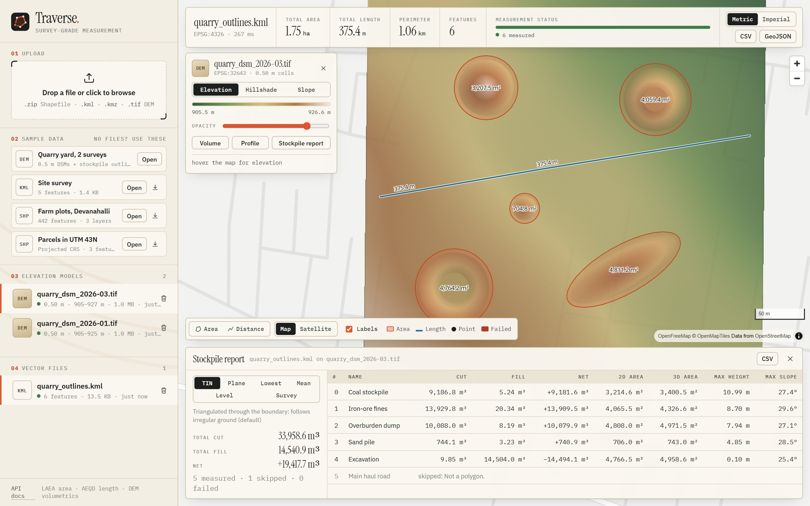
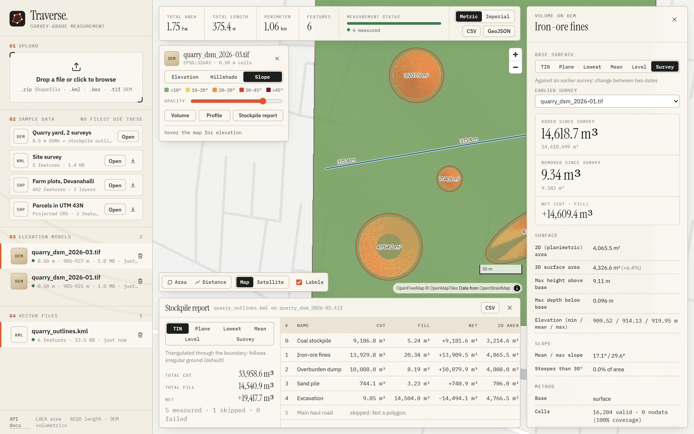
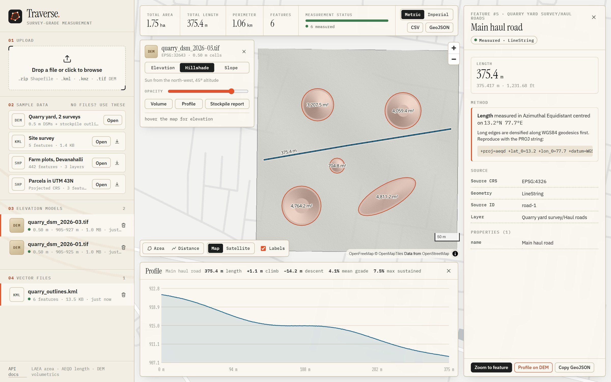
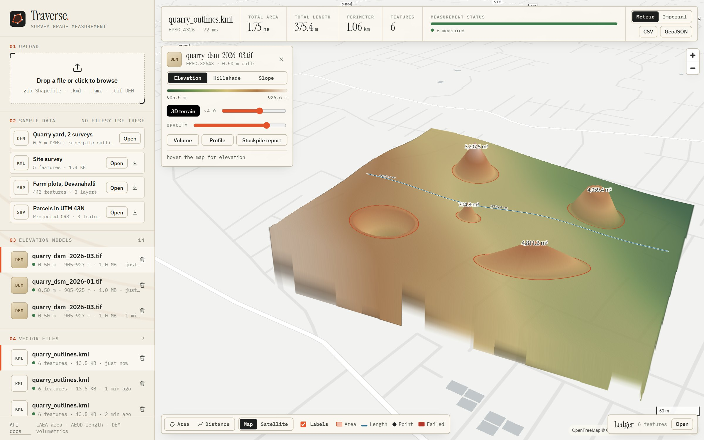

# Terrain and volumetrics

[← README](../README.md)

Drone surveys produce elevation models (DSM/DTM). Traverse turns them into the numbers
a mine or construction site runs on: how much material is in each stockpile, how much
was moved since the last survey, how steep the walls are, and the grade of a haul road.



**Try it:** open the live demo and click **Try: quarry volumes (DEM)**. It loads two
0.5 m surveys of a quarry yard (January and March) plus the stockpile outlines. Then
**Stockpile report**, click any row, switch the base surface, or pick **Survey** to see
what changed between the two dates.

## Endpoints

```text
POST /api/rasters/                        upload a DEM/DSM GeoTIFF -> Cloud-Optimised GeoTIFF
GET  /api/rasters/{id}/                   metadata: CRS, resolution, bounds, elevation range
POST /api/rasters/{id}/volume/            cut / fill / net, 3D area, slope inside one polygon
POST /api/rasters/{id}/volumes/           the same for every polygon of an uploaded file
POST /api/rasters/{id}/profile/           elevation profile and grades along a line
GET  /api/rasters/{id}/altitude/          elevation at a point
GET  /api/rasters/{id}/tiles/{z}/{x}/{y}.png?style=elevation|hillshade|slope|terrarium
```

```bash
curl -F "file=@samples/quarry_dsm_2026-03.tif" http://localhost:8000/api/rasters/
curl -F "file=@samples/quarry_outlines.kml" http://localhost:8000/api/files/
curl -X POST http://localhost:8000/api/rasters/{dem_id}/volumes/      -H "content-type: application/json"      -d '{"file_id": "{outlines_id}", "base": {"method": "triangulated"}}'
```

Full request and response schemas are in the OpenAPI docs at `/docs`.

### What it computes

| Output | How |
|---|---|
| **Cut / fill / net** | Σ (DEM − base) × true cell area over cells whose centre is inside the polygon. Cut is material above the base (stockpile), fill is void below it (pit), the same convention as Pix4D and DroneDeploy |
| **3D surface area** | Σ cell area × √(1 + (∂z/∂x)² + (∂z/∂y)²), from central differences in metres |
| **Slope** | arctan of the gradient magnitude: mean, max, % of area steeper than a threshold (default 30°) |
| **Profile** | Geodesically densified line, bilinear DEM samples, cumulative geodesic distance, climb and descent, mean grade, and the **max sustained grade** over ~5 cells (single-cell grades are noise) |
| **Map tiles** | rio-tiler reads only the COG blocks or overviews needed. Hillshade (Horn, sun 315°/45°) uses each tile's true ground pixel size; cubic resampling *and* cubic reprojection (the nearest-neighbour default stair-steps slope) |

### Base surfaces

| Method | Base under the material | Use when |
|---|---|---|
| `triangulated` (default) | TIN through DEM samples along the boundary | Irregular ground |
| `plane` | Least-squares plane through the boundary | Sloped, even ground |
| `lowest` / `highest` / `mean` | Flat at that boundary elevation | Flat pads only; warns when boundary relief exceeds 1 m |
| `custom` | Flat at a given elevation | Design or floor levels |
| `surface` | **Another DEM**, resampled onto this grid (bilinear) | Survey-to-survey change, plan against actual |

### Cell size in metres, in any CRS

Volume errors start with cell area. A 0.5 m UTM cell 277 km from the central meridian
is **0.4997 m** on the ground: UTM scale factor k = 1.00055, which makes areas 0.11%
too big if ignored. Traverse divides projected cell sizes by the local scale factors
from `pyproj.Proj.get_factors`, and for lon/lat DEMs computes geodesic cell width and
height per row. The test suite checks that the same cone stored in UTM and in degrees
gives the same volume.

### Accuracy (checked with the sample surveys)

The sample DEMs are synthetic so every volume has an exact answer: a cone, a frustum, an
elliptic cone and an inverted frustum on undulating, sloped ground with 2 cm survey noise.

| Feature | True volume | TIN base | Plane base | Lowest-point base | **Survey compare** |
|---|---:|---:|---:|---:|---:|
| Coal stockpile (cone) | 9,021 m³ | +1.8% | +0.9% | +22% | change: **5,484 m³** (true 5,477) |
| Iron-ore fines (frustum) | 14,611 m³ | −4.7% | −2.0% | +28% | **14,619 m³ (+0.05%)** |
| Overburden dump (elliptic cone) | 10,042 m³ | +0.5% | −3.7% | +71% | unchanged |
| Sand pile (cone) | 753 m³ | −1.2% | −2.1% | +55% | unchanged |
| Excavation (pit) | 14,462 m³ | +0.3% | +1.3% | −25% | deepened: **6,208 m³** (true 6,198) |

What the table shows:
- **Arithmetic isn't the limit; knowing the ground under the pile is.** With one survey,
  any base surface is an estimate. Here the ground undulates by ±1.3 m, so TIN and plane
  land within 0.3–4.7%.
- **Comparing two surveys removes that uncertainty** (+0.05%). This is why mines fly the
  same site repeatedly.
- **A flat lowest-point base on sloped ground overestimates by 22–71%.** DroneDeploy's
  docs warn about the same trap, and Traverse flags it in the response.







**3D terrain** uses Terrarium-encoded tiles (`style=terrarium`, h = R·256 + G + B/256 − 32768)
as a MapLibre `raster-dem` source. Heights are relative to the DEM minimum: outside the
DEM MapLibre assumes 0 m, so absolute heights (~915 m here) would stand the site on a
kilometre-high plinth. Tiles outside the DEM are served as flat 0 m tiles, never `204`:
a raster-dem source can't decode an empty response, and failed DEM tiles stop MapLibre
drawing the terrain at all. That bug blanked the whole map until I tracked it down.

### Ingestion

Uploads must be single-band, north-up GeoTIFFs with a CRS. Imagery (3+ byte bands) and
rotated rasters are rejected with a clear message. Each upload is converted to a
**Cloud-Optimised GeoTIFF** (512 px tiles, DEFLATE with the floating-point predictor,
averaged overviews). Analyses then read only the blocks under a polygon, and low-zoom
tiles read overviews. Elevation statistics come from overviews, so a 250-million-cell
DEM never loads fully into memory. Blobs live behind a small storage interface (`put`,
`gdal_path`, `delete`) so they can move to S3.
