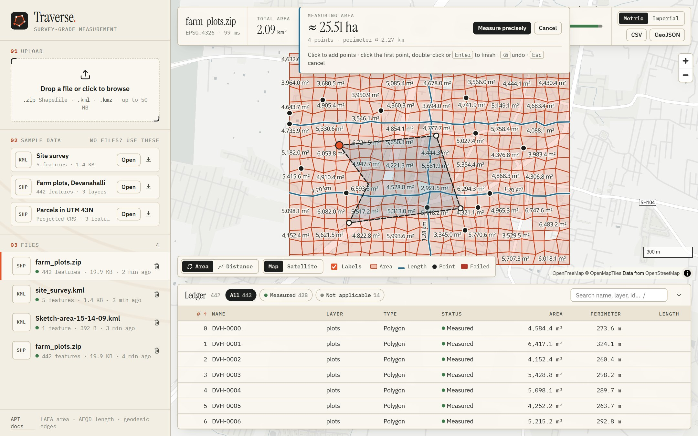

# Traverse web UI

[← README](../README.md)

**Traverse** is named after the surveyor's traverse: walk a chain of stations,
measure every leg, close the loop. The mark is exactly that, a closed five-station
traverse. The interface uses the visual language of a survey plan: paper and ink
tones, a survey-flag orange, serif readouts and monospaced figures that line up like a
field book. Everything on screen comes from the public API; the UI has no private
endpoints.

| | |
|---|---|
|  |  |

- **Map.** Features are coloured by kind and status (failed and unsupported stand
  out), with on-map area and length labels in the current units. Map or **satellite**
  basemap, scale bar, hover tooltips.
- **Readout.** Total area, length and perimeter, feature count, a status breakdown
  bar, metric/imperial switch, CSV and GeoJSON export.
- **Ledger.** A virtualised table (only visible rows are rendered, so 100k features
  stay smooth): sort by any column, filter by status, search (`/` to focus). Click a
  row to fly to the feature.
- **Inspector.** Big readouts with exact values (m² and acres, m and ft), the
  **projection behind each value** (e.g. "LAEA centred on 13.2°N 77.7°E" plus the PROJ
  string to reproduce it), notes such as "invalid polygon repaired", source CRS and
  all attributes. Copy the geometry as GeoJSON.
- **Upload.** Drag and drop with real upload progress, then a processing state. Errors
  show the API's code and message, with a link to the recorded FAILED file.
- **Draw & measure.** No file? Sketch one. Pick **Area** or **Distance**, click
  points on the map and watch a live on-the-sphere estimate. Double-click or press
  `Enter` and the sketch goes through the real pipeline as a KML upload, coming back
  with the exact ellipsoidal value. `⌫` undoes a point, `Esc` cancels.
- **Linked hover.** Hovering a row in the ledger highlights that feature on the map,
  and hovering a feature on the map highlights its row.
- **Drop anywhere.** Drag a file over any part of the window to upload it.
- **Animated totals.** Readout totals count up when a file opens or the units change.
- **Shareable state.** `?file=<id>&feature=<n>&basemap=satellite` restores the exact
  view. `Esc` closes the inspector.

Basemaps are keyless: [OpenFreeMap](https://openfreemap.org) vector tiles and Esri
World Imagery. Fonts are bundled (Latin subsets only), and MapLibre is split into its
own long-cached chunk.
